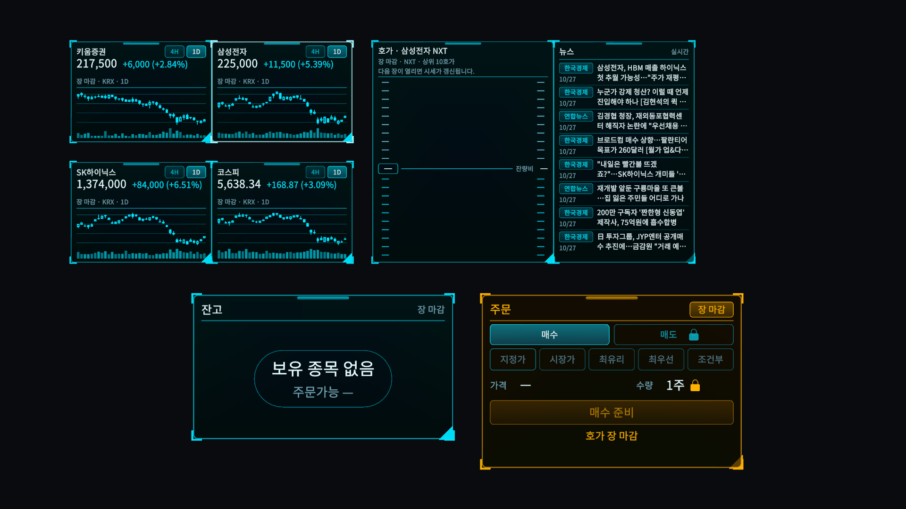

# Spatial Trading — Quest 3

A staged mixed-reality trading prototype. Interfaces produce typed actions; components consume application context and financial capabilities. Brokerage and Gemini secrets belong on the gateway.

**Current state:** Milestone 0 is documented and the original M1 shell is verified in Unity, an inspected Android build and Meta XR Simulator. On 2026-10-27 the user decided to use the Kiwoom production domain and to allow kiwoom-cli documentation and implementation as the basis, so the repository-spec-only gate is retired (see the [design](docs/superpowers/specs/2026-10-27-investment-jarvis-design.md) and the [live market pipeline plan](docs/superpowers/plans/2026-10-27-live-market-pipeline.md)). The gateway now implements token issuance (au10001), daily and 4-hour candles for stocks and the KOSPI index, realtime trade/book (0B/0D) for KRX and NXT, realtime index (0J) data, a read-only masked account balance, a news feed, and a `/v1/stream` WebSocket to the Unity client (see [architecture](docs/ARCHITECTURE.md)). The live gateway was verified against the Kiwoom production API on 2026-10-28 while the market was closed (`artifacts/trader-spread/gateway-live.txt`): token issuance succeeded, every heartbeat reported the broker connected, and the daily/4-hour candles and the balance arrived with values labelled DELAYED · MARKET_CLOSED, with no secret in the gateway log. Realtime ticks (0B/0D/0J) and LIVE labels during market hours have not been captured yet, and the Quest 3 headset checks are pending. No orders are submitted; `/v1/orders` still returns 404.

- [Roadmap and current gates](docs/ROADMAP.md)
- [Milestone 2 scope and verification](docs/MILESTONE_2.md)
- [Meta-guided design system](docs/DESIGN_SYSTEM.md)
- [Gateway setup](gateway/README.md)
- [Architecture](docs/ARCHITECTURE.md)
- [Interaction model](docs/INTERACTION_MODEL.md)
- [Action model](docs/ACTION_MODEL.md)
- [Financial models](docs/FINANCIAL_MODELS.md)
- [Order safety](docs/ORDER_SAFETY.md)
- [Kiwoom API mapping and K-01–K-10 status](docs/KIWOOM_API_MAPPING.md)
- [Failure model](docs/FAILURE_MODEL.md)
- [Milestone 1 evidence and acceptance](docs/MILESTONE_1.md)
- [Unity setup and build commands](docs/QUEST_SETUP.md)
- [Third-party notices](docs/THIRD_PARTY_NOTICES.md)

`quest/` is the Unity project. `scripts/` contains reproducible validation/build entry points. `tests/Domain/` compiles the exact pure C# sources and tests used by Unity under .NET, without substituting for Unity or headset validation.

## Trader spread scene

The Unity scene is `TraderSpread` (the only build scene; the old FocusShell picker is retired). It lays out eight flat, front-facing panels: three stock charts, a KOSPI chart, an order book, news, balance and an order panel. Panels can be grabbed, moved on a grid, resized from a corner handle and flicked away; see the [interaction model](docs/INTERACTION_MODEL.md). The order panel only prepares and previews a ticket: nothing is sent and `/v1/orders` still returns 404. Generate the scene with the Unity menu **Spatial Trading → 2. Generate Trader Spread scene** (or `scripts/unity.sh scene`).



The image is an automated Unity editor Play-mode capture (no XR runtime, camera rendered to PNG) from the live gateway stream while the market was closed, so panels show 장 마감 and empty book levels. The account line is redacted in the image. It is neither a Meta XR Simulator nor a Quest 3 capture.

## Run the gateway

Use `scripts/gateway.sh`, not a hand-written `uvicorn` command. It starts the gateway with `gateway/.env` and first unsets `KIWOOM_APPKEY`, `KIWOOM_SECRETKEY` and `DART_API_KEY` in the process environment. This matters because an `export KIWOOM_APPKEY=...` in `~/.zshrc` (for example for kiwoom-cli) would otherwise win over `gateway/.env`, and the gateway would quietly authenticate with a different app key than the one in the file. The host and port default to `127.0.0.1:8471` (`GATEWAY_HOST`, `GATEWAY_PORT` override them).

```bash
cp gateway/.env.example gateway/.env   # then fill in the values; the file is git-ignored
scripts/gateway.sh
```

Environment keys read by `Settings.from_env` (`gateway/src/spatial_gateway/settings.py`). Values below are placeholders; never commit real ones.

| Key | Required | Meaning |
| --- | --- | --- |
| `KIWOOM_APPKEY`, `KIWOOM_SECRETKEY` | yes | Kiwoom app key and secret |
| `GATEWAY_PAIRING_TOKEN` | yes | 32+ characters; the Unity client sends it to subscribe |
| `GATEWAY_WATCH_CODES` | yes | comma-separated 6-digit stock codes, e.g. `005930,000660` |
| `GATEWAY_ALLOWED_HOSTS` | yes | accepted `Host` header values; add the Mac's LAN IP for a headset |
| `DART_API_KEY` | no | OpenDART key for filings in the news panel; without it only RSS headlines appear |
| `GATEWAY_INDEX_CODES` | no | comma-separated 3-digit index codes; default `001` (KOSPI) |
| `GATEWAY_NEWS_FEEDS` | no | comma-separated `https://` RSS URLs; empty uses the built-in 한국경제 and 연합뉴스 feeds |

## Known limits

- 주문가능 (orderable cash) is not a reliable "can buy" signal in the demo. It shows "—" whenever the amount is unknown: when there is no last price to price the query (after the close quotes are UNAVAILABLE, so this is the usual after-hours reading) and when the query fails. During market hours the demo account, which has no cash, reads "0원" (the live query returns a zero amount). "—" therefore does not mean the account is empty, and neither "—" nor "0원" says a buy is affordable. A real S4 buy needs funds deposited first; until then the order panel cannot show an affordable size.
- Outside KRX/NXT sessions the panels keep the last values labeled 장 마감, so book depth and prices can be empty.
- Account, balance and news are read-only. Voice/Gemini integration and order execution are not enabled.

The original Kiwoom workbook (K1) stays local and is excluded from Git because its examples contain credential-shaped values; its source hash is recorded in [API mapping](docs/KIWOOM_API_MAPPING.md). Since 2026-10-27 it is no longer the sole source: kiwoom-cli documentation and implementation are also accepted. The former `BLOCKED_BY_MISSING_SPEC` gate was retired for market data; order-related items move to a follow-up plan.
