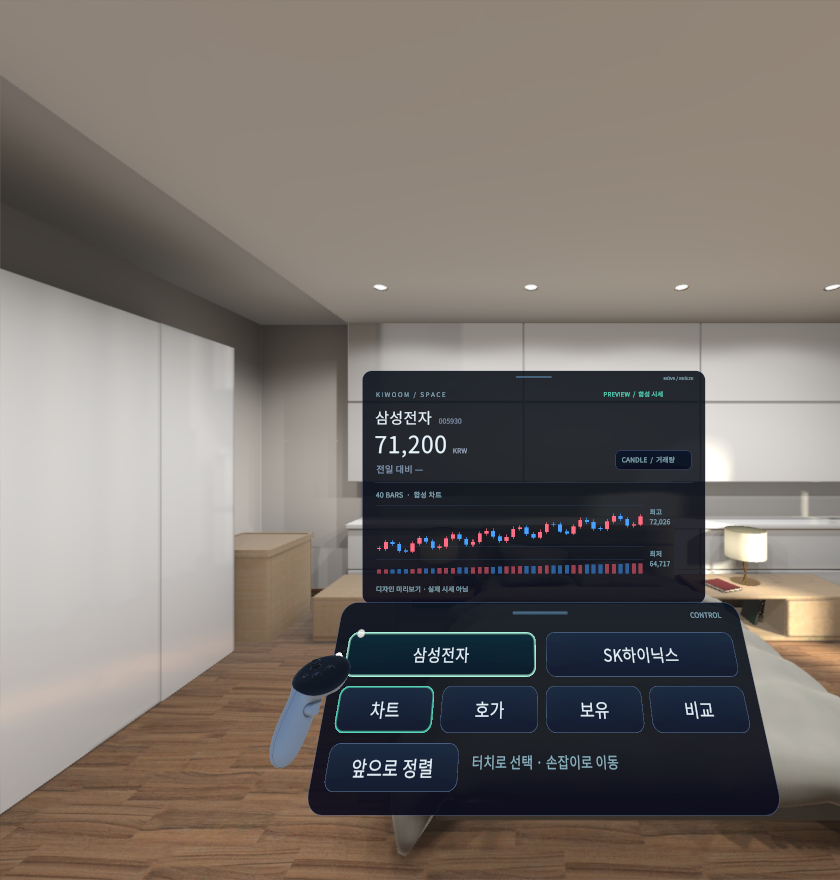

# Spatial Trading — Quest 3

A staged mixed-reality trading prototype. Interfaces produce typed actions; components consume application context and financial capabilities. Brokerage and Gemini secrets belong on the gateway.

**Current state:** Milestone 0 is documented and the original M1 shell is verified in Unity, an inspected Android build and Meta XR Simulator. On 2026-10-27 the user decided to use the Kiwoom production domain and to allow kiwoom-cli documentation and implementation as the basis, so the repository-spec-only gate is retired (see the [design](docs/superpowers/specs/2026-10-27-investment-jarvis-design.md) and the [live market pipeline plan](docs/superpowers/plans/2026-10-27-live-market-pipeline.md)). The gateway now implements token issuance (au10001), 1-minute candles (ka10080), realtime trade/book (0B/0D) for KRX and NXT, and a `/v1/stream` WebSocket to the Unity client. **None of this has been verified against the live Kiwoom API:** au10001 currently returns 8001 (app key/secret validation failed), so verification is offline only (gateway pytest, .NET domain tests, a spec-example fixture). Unity EditMode, editor and Quest 3 checks are pending. No orders are submitted; `/v1/orders` still returns 404.

- [Roadmap and current gates](docs/ROADMAP.md)
- [Milestone 2 scope and verification](docs/MILESTONE_2.md)
- [Meta-guided design system](docs/DESIGN_SYSTEM.md)
- [Gateway setup](gateway/README.md)
- [Architecture](docs/ARCHITECTURE.md)
- [Interaction model](docs/INTERACTION_MODEL.md)
- [Action model](docs/ACTION_MODEL.md)
- [Financial models](docs/FINANCIAL_MODELS.md)
- [Order safety](docs/ORDER_SAFETY.md)
- [Kiwoom API mapping and K-01–K-10 status](docs/KIWOOM_API_MAPPING.md)
- [Failure model](docs/FAILURE_MODEL.md)
- [Milestone 1 evidence and acceptance](docs/MILESTONE_1.md)
- [Unity setup and build commands](docs/QUEST_SETUP.md)
- [Third-party notices](docs/THIRD_PARTY_NOTICES.md)

`quest/` is the Unity project. `scripts/` contains reproducible validation/build entry points. `tests/Domain/` compiles the exact pure C# sources and tests used by Unity under .NET, without substituting for Unity or headset validation.

The shell keeps an explicit, static synthetic catalog and chart for development. Position data is unavailable. In gateway mode, quotes, books and minute candles are pushed over the gateway stream once the gateway holds a valid Kiwoom app key; without one they show as DISCONNECTED (`KIWOOM_AUTH`). Outside trading sessions the last session's values stay visible as 장 마감 (`MARKET_CLOSED`). Account connection, voice/Gemini integration and order execution are not yet enabled.

The image records the current Focus surface. The room is a simulator environment. All displayed prices and candles are synthetic fixtures. This is not a capture of live market data or a physical Quest session.

When the gateway cannot provide data, the same surface shows the values' status with an explicit reason; it never activates preview automatically. [Gateway-state capture](docs/images/milestone2-gateway.png).

The original Kiwoom workbook (K1) stays local and is excluded from Git because its examples contain credential-shaped values; its source hash is recorded in [API mapping](docs/KIWOOM_API_MAPPING.md). Since 2026-10-27 it is no longer the sole source: kiwoom-cli documentation and implementation are also accepted. The former `BLOCKED_BY_MISSING_SPEC` gate was retired for market data; order-related items move to a follow-up plan.
