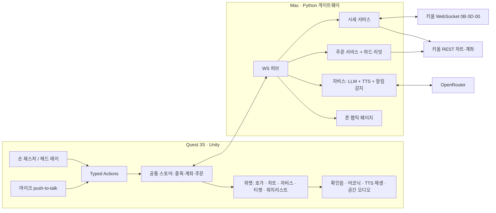

# 투자 자비스 — XR 영웅문 발표 버전 설계

작성 2026-10-27. 이 문서는 지금까지의 `docs/` 설계(M0–M9 로드맵)를 대체하는 것이 아니라, 11월 말 발표까지 무엇을 어떤 순서로 만들지 정한다. 충돌하는 부분은 [기존 문서와의 관계](#9-기존-문서와의-관계)에서 정리한다.

표기: **(사용자 결정)** 은 사용자가 직접 정한 것, **(Claude 판단)** 은 대화 중 Claude가 정하고 사용자에게 알린 것이다. 표시 없는 내용은 사용자의 비전 문서에서 온 것이다.

## 1. 의도와 이유

키움랩 3개월 프로젝트(2026.8–11)의 산출물이며, 11월 말 최종 발표에서 라이브로 시연한다. 한 문장 정의: **"2026년의 기술은 아이언맨의 자비스에 얼마나 가까워졌는가"를 측정하는 XR 트레이딩 프로토타입.** 데모가 아니라 아래 테제를 코드로 검증하는 측정 도구다.

1. **사용 맥락이 전부다.** 한국 직장인 투자자의 두 장면 — 사무실(무음, 즉시 이탈)과 지하철(소음, 한 손, 밀착).
2. **화면은 사적, 입력은 공적.** 탐색은 음성, 결정·주문은 무음 손 제스처라는 입력 포트폴리오.
3. **조회는 무마찰, 주문은 설계된 마찰.** 손동작 오인식은 증권에서 오발주다. 주문 앞 확인 절차는 의무다.
4. **아이즈프리 = 접근성 = 전 사용자 경험(연석 효과).** 고유수용감각 입력 + 소리·진동 피드백만으로 조회→주문이 완결된다.
5. **XR 영웅문은 HTS의 귀환.** 다중창·자유배치 위젯 구조를 공간에 복원한다. UI는 공통 데이터 위의 독립 컴포넌트다.
6. **XR과 휴머노이드는 같은 기술의 양방향.** 수동 모드 전환은 월드모델이 자동화할 자리표시자다.

**사용자가 가장 원하는 결과 (사용자 결정):** 시장 최고의 XR 키움 앱. 특히 UI/UX — 헤드셋을 쓴 사람과 발표 청중에게서 "와" 소리가 나오는 것. 시각·청각 완성도는 꾸밈이 아니라 핵심 요구사항이다.

발표자는 신중한 실용주의자 얼리 어댑터로서, 청중(대부분 얼리 머조리티)에게 "이건 쓸 만하다/아직이다"를 판정해 주는 위치에서 말한다. 그래서 과장된 가짜보다 **진짜로 작동하는 것**이 더 큰 감탄을 만든다. 실제 시세, 실제 계좌, 실제 1주 주문이 이 프로젝트의 무기다.

## 2. 목표, 비목표, 안티골

**목표**
- 발표 무대의 장면(§5)이 Quest 3S에서 실제 키움 데이터로 끊김 없이 돌아간다.
- 헤드셋 없이도 같은 장면을 Unity 에디터/시뮬레이터에서 재현할 수 있다(개발 수단이자 발표 백업).
- 처음 써보는 사람이 설명 없이 30초 안에 "와"라고 말한다.

**비목표 (이번 한 달에 하지 않음)**
- 실학습 기반 행동패턴 대시보드(사전 구성 데이터로 연출, 코드에 명시).
- 미국주식, 신용, 정정/취소 주문 UI, 다계좌.
- 범용 배포·스토어 출시·다중 사용자.
- 월드모델 기반 자동 컨텍스트 전환.

**안티골 (기술적으로 돌아가도 실패인 것)**
- 확인 절차를 어떤 경로로든 건너뛰고 실주문이 나가는 것. 음성·AI·호버·우발적 핀치가 주문을 확정하는 것.
- 합성/대본 데이터를 실제 시세처럼 보이게 하는 것. WoZ는 숨기지 않는다.
- 2D 대시보드를 공중에 띄운 것처럼 보이는 것 — "모니터를 얼굴에 붙인 것"은 감탄이 아니라 실망이다.
- 패스스루 위에서 숫자가 안 읽히는 홀로그램. 예쁘지만 못 읽으면 실패다.
- 발표 당일 네트워크·토큰 문제로 시연이 멈추는 것.

## 3. 제약

| 항목 | 내용 |
|---|---|
| 일정 | 발표 11월 말, 오늘 기준 약 4–5주. 마지막 주는 실기기 리허설에 비워 둔다 (Claude 판단). |
| 기기 | 대상 Quest 3S(회사 예산). **2026-10-29(목) 도착 예정, 개발자 모드 허용 (사용자 결정).** 그 전까지 손 제스처는 Meta XR Simulator로 개발하고, 도착 후 바로 실기기 사이드로딩·튜닝을 시작한다. |
| 폰 | **아이폰 (사용자 결정).** iOS Safari는 웹 진동 API를 지원하지 않는다. |
| 발표 시간대 | 11월 말. 정규장 밖이어도 애프터마켓(NXT)이 열려 있어 실시간 장면은 그대로 성립한다 (사용자 결정). |
| 엔진 | **Unity + Python (사용자 결정).** 기존 `quest/` (Unity 6000.0.67f1, Meta XR SDK core/interaction 205.0.0, OpenXR 1.18, XR Hands 1.7.2)와 `gateway/` (FastAPI, Python ≥3.11)를 이어서 쓴다. 비전 문서의 WebXR/three.js/Node 스택은 쓰지 않는다. |
| 키움 | **실전투자 도메인 사용, 모의투자 대신 (사용자 결정).** 키움 REST/WS 직접 호출 허용, kiwoom-cli 활용은 선택 (사용자 결정). |
| 키움 스펙 출처 | 2026-09-20의 "저장소 워크북만 사용" 정책은 폐기된다 (사용자 결정, 2026-10-27). 근거 자료: `~/dev/kiwoom-cli/docs/키움 REST API 문서.xlsx`·`.pdf`와 kiwoom-cli의 검증된 구현(`~/dev/kiwoom-cli/kiwoom_cli/`). |
| 앱키·계좌 | **team-03 프로젝트가 쓰는 앱키를 그대로 쓰고, kiwoom-cli는 `default` 프로필을 쓴다 (사용자 결정).** team-03 `members/gejyn14/app/.env`의 `KIWOOM_APPKEY`와 `kiwoomxr/docs/62258392_appkey.txt`는 같은 키다(지문 비교로 확인). 키움 앱키는 계좌에 묶이므로 실주문 계좌는 이 키의 계좌다. 빌더는 ka00001로 계좌를 조회해 **마스킹한 계좌번호를 첫 LIVE 전에 사용자에게 확인받는다.** 현재 kiwoom-cli `default` 프로필은 다른 앱키와 자리표시자 계좌(7자리)로 설정되어 있으므로, 같은 키로 재설정이 필요하다(사용자 승인 후). |
| 토큰 | team-03 앱도 같은 키로 스스로 토큰을 발급한다(`peerdesk/kiwoom.py`). 새 발급이 다른 쪽 토큰을 무효화하는지는 미검증이다. 두 앱이 동시에 돌면 토큰을 서로 빼앗을 수 있다. |
| AI | Gemini API 키 없음. OpenRouter 키는 `~/dev/terms`에 있다. **OpenRouter를 통해 Gemini Flash 계열을 호출하고, 공급자·모델은 설정 한 줄로 교체 (Claude 판단).** 키는 게이트웨이 `.env`에만. |
| 작성자 | XR 코딩 경험 없음(Python·도메인 지식 있음). 모든 단계에 실행·확인 방법을 남긴다. |
| 시연 환경 | 핫스팟 네트워크(회사 와이파이 금지), Quest 캐스팅으로 착용자 시점 송출. 정규장(09:00–15:30) 밖이면 실주문 장면은 사전 녹화로 대체. |

## 4. 시스템 구성

- **Unity ↔ 게이트웨이는 WebSocket 푸시 (Claude 판단).** 현재의 HTTP 폴링 + 30초 캐시로는 실시간 호가가 살아 움직이지 않는다. 게이트웨이가 키움 WS 연결 **하나**를 유지하고 Unity에 팬아웃한다.
- **Quest는 LAN으로 Mac 게이트웨이에 접속한다.** 현재의 localhost 제한은 풀되, 게이트웨이 시작 시 표시되는 페어링 코드(또는 공유 토큰) 없이는 접속을 거부한다 (Claude 판단).
- **토큰은 게이트웨이가 직접 발급·관리한다 (Claude 판단).** 앱키·시크릿은 게이트웨이 `.env`(커밋 금지)에서 읽는다. 토큰 무효(8005) 시 1회 재발급을 시도하되 분당 횟수를 제한하고, 상태 패널에 토큰 재발급 사실을 표시한다(무한 핑퐁 방지). 새 발급이 team-03 토큰을 무효화하는지는 team-03이 쉬는 시간에 사용자 동의를 받고 한 번 확인한다. **시연·리허설 중에는 team-03 앱을 끈다**(발표 체크리스트 항목).
- **위젯은 서로를 직접 참조하지 않는다.** 공통 스토어(선택 종목, 계좌 요약, 주문 상태)만 구독한다. 기존 `Domain/` 의 순수 C# 상태·액션 모델과 .NET 테스트 하네스를 이어서 쓴다.
- **자비스는 주문을 확정할 수 없다.** LLM 출력은 허용 목록의 Typed Action(종목 선택, 패널 열기, 브리핑 표시, 주문 티켓 *열기*)으로만 앱에 들어온다. 확인·전송은 손 제스처 전용이다.

## 5. 발표 장면 = 인수 기준

각 장면은 Quest 3S와 에디터/시뮬레이터 양쪽에서 재현 가능해야 한다. "와 포인트"는 그 장면이 감탄을 노리는 지점이다. 연출 세부는 빌더가 시뮬레이터 캡처로 반복하며 정한다.

### P0 — 반드시 (1–3주차)

**S1. 부팅 — 자비스가 깨어난다.**
헤드셋을 쓰면 패스스루 방 안에 스캔라인이 훑고, 패널들이 손목/정면 한 점에서 조립되듯 펼쳐지며 부팅음이 난다. 이미 실시간으로 움직이는 삼성전자 호가가 보인다.
와 포인트: 첫 3초. 방이 화면으로 바뀌는 게 아니라, 내 방에 홀로그램이 *생겨난다*.

**S2. 살아 있는 시장 — 실시간 호가와 차트.**
키움 0B(체결)·0D(호가잔량)로 호가 10단계와 분봉 차트가 실제 시세로 갱신된다. 정규장 밖에서는 NXT 애프터마켓 시세를 쓰고, 어느 시장 데이터인지 라벨로 보인다. 빌더는 키움 문서로 NXT 종목코드·실시간 등록 방식을 확인한다. 호가 잔량은 평면 표가 아니라 깊이를 가진 빛 막대로, 체결이 들어올 때마다 해당 가격대가 맥동한다. 차트 최신 봉은 체결과 함께 자란다. 출처·시각 라벨은 유지한다.
와 포인트: 숫자가 아니라 *시장이 숨 쉬는 것*이 보인다. 2D로는 못 하는 표현이어야 한다.

**S3. 자비스에게 묻기.**
push-to-talk 제스처(Claude 판단: 한국어 로컬 웨이크워드는 한 달 안에 위험하므로 기본은 제스처, "자비스" 웨이크워드는 P2) → 짧은 오디오 클립 → 게이트웨이 → OpenRouter(Gemini Flash 오디오 입력) → 자비스 패널에 응답 스트리밍 + 한국어 TTS. "삼성전자 어제보다 어때?", "브리핑해줘(핵심 3가지)". 게이트웨이는 요약 시세(현재가·등락·거래량 몇 줄)만 프롬프트에 넣는다.
TTS는 Mac 게이트웨이에서 생성해 Unity로 보낸다 (Claude 판단: Quest에 한국어 TTS 엔진이 있다고 가정할 수 없음; macOS `say` 한국어 음성 등은 빌더가 품질 비교).
WoZ 토글(`DEMO_MODE=script`)이면 같은 경로에서 사전 스크립트 응답을 쓴다. 화면 어딘가에 모드를 정직하게 표시한다.
와 포인트: 말을 마치자마자 홀로그램 패널이 응답을 *쓰기 시작*하고 목소리가 겹친다. 응답 대기 중에도 "듣고 있다/생각 중" 상태가 시각·청각으로 살아 있어야 한다.

**S4. 실주문 — 설계된 마찰.**
종목 → 주문 티켓 펼침 → 수량 후보 3개(실주문 모드에선 1주만 활성) → 핀치 선택 → 티켓을 집어 앞으로 밀어 넣는 확인 제스처 → 전송 → 키움 주문체결 실시간(00)으로 접수·체결 확인 → 소리 + 패널 (+ P1 폰 알림).
- 기본 모드 `PREFLIGHT`: 실전 계좌·시세에 대해 사전점검(현재가·예수금·잔고 조회; kiwoom-cli `order validate`가 쓰는 ka10001/kt00001/kt00004와 같은 성격)만 하고 **전송하지 않는다.** 화면에 "검사만 함"이 보인다 (Claude 판단).
- `LIVE` 모드: 게이트웨이 환경변수 + 헤드셋 안의 명시적 무장(arm) 동작 둘 다 있어야 켜진다. 켜지면 시야와 로그에 LIVE 배지가 상시 표시된다.
- 서버 하드코딩(클라이언트 값 불신): 종목 005930만, 수량 1주만, 매수만, 키움이 주문을 받는 거래 세션(정규장 또는 NXT 애프터마켓)만, 동시에 진행 중인 주문 1건, 자동 재시도 없음, 하루 실주문 상한 3건(시뮬레이터·Mac 백업·리허설 포함, Claude 판단). 전송 결과가 불확실하면 UNKNOWN으로 표시하고 재전송하지 않는다.
- LIVE 조건은 모든 클라이언트에 같다: 게이트웨이 설정 + 앱 안의 무장 동작 + 티켓 확인. Mac 백업과 시뮬레이터도 같은 조건을 만족하면 실주문할 수 있다 (Claude 판단: 게이트웨이는 손동작을 진짜로 검증할 수 없으므로, 경로 차별 대신 무장·상한·배지로 막는다).
- 주문 유형 (Claude 판단: 발표 장면에서 체결이 확실해야 함): 정규장은 시장가 1주. 애프터마켓(NXT)은 시장가가 안 될 수 있으므로 현재 최우선 매도호가 지정가 1주. 빌더는 키움 문서로 세션별 주문 유형·거래소 구분 필드를 확인한다.
- 체결 피드백: 소리 + 패널 + (P1) 폰 알림. 아이폰이라 폰 진동은 P0에서 뺀다.
와 포인트: 티켓을 *물리적으로 밀어 넣는* 손맛, 그리고 몇 초 뒤 진짜 체결 알림. "방금 진짜로 산 거예요?"가 목표 반응이다.

**S5. 콜드 오픈 — 눈 감고 주문.**
아이즈프리 모드: 시각 정보 없이 핀치=항목 순회, 더블핀치=선택, 확인음·어코닉·TTS로 피드백, 확인은 S4와 같은 마찰을 소리 문법으로 재현. 제스처 어휘는 위치가 아니라 동작 기반(핀치, 더블핀치, 손목 회전). 모든 입력에는 반드시 즉각 확인음이 따른다. 공간 오디오로 항목의 방향감을 준다 (Claude 판단, 실기기에서 효과 검증).
와 포인트: 청중이 스크린에서 *아무것도 안 보이는데* 주문이 완결되는 걸 듣는다.

**S6. 백업 경로.**
헤드셋·네트워크가 죽어도 같은 앱을 Mac에서 마우스/키보드로 시연할 수 있다(에디터 플레이 모드 또는 데스크톱 빌드 — 빌더 결정). 전 과정 녹화 영상도 준비한다.

### P1 — 하면 좋음 (3–4주차)

- **S7. 선제 알림.** 게이트웨이가 실제 시세에서 급등락·VI 발동(실시간 1h)·거래량 급증을 감지하면 시야 가장자리에서 패널이 날아들며 소리로 알린다. 발표 중 실제 이벤트가 없을 수 있으므로 시연용 트리거(명시적 표시)를 둔다.
- **S8. 컨텍스트 모드.** 사무실(가장자리 미니 위젯, 무음 글로우, 한 동작으로 전부 숨기는 보스 모드) / 지하철(정면 대형 패널, 한 손). 수동 토글이며 월드모델 자리표시자임을 주석으로 남긴다.
- **S9. 폰 햅틱 (아이폰).** 웹 진동 API가 없으므로, 게이트웨이가 제공하는 페이지를 홈 화면 웹앱으로 설치하고 웹 푸시 알림(iOS 16.4+)으로 진동시킨다 (Claude 판단). 푸시는 Apple 서버를 거치므로 알림 내용에 계좌·금액 등 금융 정보를 넣지 않는다("주문 확인됨" 수준). 무음·집중 모드면 진동하지 않을 수 있다 — 발표 체크리스트 항목.
- 손목 워치리스트(손목을 들여다보면 표시).

### P2 — 여유 시

"자비스" 웨이크워드, 종목 엔티티 드래그(워치리스트→차트/자비스), 배치 모드 3종(world/head/wrist), 추가 셰이더 연출.

## 6. 시각·청각 방향 ("와"의 재료)

- **미학 (사용자 결정, 2026-10-27): 아이언맨 영화 속 자비스 홀로그램에 최대한 가깝게.** 반투명 청록(#00e5ff 계열) 단일 색조, 가는 선과 눈금, 겹겹이 회전하는 원형 링·호(arc), 방사형 HUD 레이아웃, 패널 모서리 브래킷, 데이터 판독 텍스트, 글로우·스캔라인, 등장 시 선→면으로 조립되는 애니메이션과 약한 글리치 깜빡임, 경고는 호박색 계열 강조. 부팅음·확인음·패널 전환음. 기존 DESIGN_SYSTEM의 "불투명 남색 + 민트"는 이 방향으로 대체한다. 영화의 분위기를 참고해 직접 만들고, 영화 에셋·로고·스크린샷을 앱에 넣지 않는다.
- **차트는 Unity 네이티브로 직접 그린다 (사용자 결정, 2026-10-27).** 외부 차트 라이브러리·WebView 플러그인은 쓰지 않는다. 요구사항: 확대 가능, 그리고 "XR 시대에는 차트가 컴포넌트가 된다"는 레슨을 발표에서 보여줄 것. §6.1 참고.

### 6.1 차트 컴포넌트화 — 발표 레슨

**레슨:** 2D 화면에서 차트가 한 장의 그림인 이유는 화면이 좁고 평평해서다. XR에서는 깊이가 공짜 차원이 된다. 차트는 겹쳐 그린 그림이 아니라 같은 데이터(종목·시간축)를 구독하는 부품들의 묶음이 되고, 사용자는 그 부품을 꺼내고 옮기고 다시 조합한다. 이것은 테제 5(HTS의 귀환)의 차트 버전이다.

**부품 (각각 독립 컴포넌트, 공통 스토어 구독):** 가격 캔들, 거래량, 이동평균 등 지표, 호가 깊이(가격축 공유), 체결 프린트, 가격 레벨·주석, 시간축, 크로스헤어(시간 커서).

**장면 S2-b "분해" (P0, Claude 판단):** 두 손으로 차트를 벌리면 부품들이 깊이 방향으로 분해도처럼 펼쳐진다(자비스 연출의 핵심 동작). 사용자는 거래량 층을 집어 아래로 떼어 놓고, 이동평균 층을 다른 종목 차트에 얹어 비교한다. 어느 부품에서 시간 커서를 움직여도 흩어진 모든 부품의 같은 시각이 함께 강조된다 — 부품들이 같은 데이터를 공유한다는 것이 눈에 보이는 증거다. 다시 모으면 한 장의 차트로 접힌다.

**확대 (P0):** 한 손 핀치-드래그는 시간축 이동, 두 손 벌리기/모으기는 시간축 확대/축소, Mac 백업은 스크롤·드래그. 확대는 의미 단위로 한다 — 줌아웃하면 봉 단위가 1분→5분→일봉으로 바뀌고, 글자 크기는 일정하게 유지한다. 확대 중심은 사용자가 잡은 지점이며 차트 자체가 시야를 덮도록 커지지 않는다.

**차트 UI 원칙 (리뷰 기준):**
1. 개요 먼저, 확대·필터, 세부는 요청 시 — 기본은 한 장의 차트, 분해는 사용자가 원할 때.
2. 의미적 확대 — 픽셀을 키우지 말고 정보 단위를 바꾼다. 글자는 시야각 기준 최소 크기 이하로 줄지 않는다.
3. 데이터와 표현 분리 — 부품끼리 직접 참조 금지, 공통 스토어만 구독.
4. 연결된 선택(brushing & linking) — 한 부품의 시간 커서·선택이 모든 부품에 반영된다.
5. 깊이는 정보 구분에만 — 읽는 글자는 한 평면에, 분해 깊이는 몇 단계로 제한(초점 피로 방지).
6. 조작 손잡이와 활성화 영역 분리 — 집기·벌리기가 우발적 선택이 되지 않는다. 동작 전에 무엇이 일어날지 미리 보인다.
7. 팔 피로 고려 — 두 손 동작은 짧게, 조작 영역은 가슴 아래 가까운 곳.
8. 시야 안정 — 확대·분해 중에도 세계 고정, 카메라 이동 없음, 급격한 큰 움직임 금지.
9. 색 예산 — 차트를 포함한 전체가 청록 한 가지 색조, 경고만 호박색. **상승/하락은 색이 아니라 모양으로 구분한다 (사용자 결정): 상승 = 빈 캔들, 하락 = 채운 캔들.** 등락 수치에는 +/− 부호를 붙인다. 기존 상승 코랄/하락 블루 관례는 이 앱에서 쓰지 않는다.
10. 데이터 정직성 — 출처·시장(KRX/NXT)·시각 라벨과 재생 여부를 부품이 분리돼도 각자 지닌다.
- **가독성 가드 (Claude 판단):** 홀로그램 효과는 테두리·배경·전환에 쓰고, 가격·수량 같은 숫자 뒤에는 충분히 불투명한 판을 둔다. 상승/하락은 빈/채운 캔들과 +/− 부호로 구분한다(§6.1 원칙 9). 색만으로 의미를 전달하지 않는다.
- **움직임:** 데이터 변화는 즉시 반영하되 시각 전환은 부드럽게. 시선 앞에서 갑작스러운 큰 움직임은 피한다(멀미).
- **소리 3층:** ① 확인음(모든 입력, 필수) ② 어코닉(상태 변화 0.3초 소리 문법: 상승/하락/체결/오류) ③ TTS(내용). 소리는 출처 패널 위치에서 나는 공간 오디오로.
- **판정 방법:** 장면별로 시뮬레이터 캡처(스크린샷/짧은 녹화)를 남겨 사용자가 "와"인지 직접 판단한다. 실기기 도착 후 재판정.
- 빌더는 발표 전 화면 구성안을 2–3개 캡처로 먼저 보여주고 방향을 확인받는다.

## 7. 비용·안전 가드레일 (위반 금지)

- 상시 오디오 스트리밍 금지. push-to-talk(또는 이후 로컬 웨이크워드) 이후의 짧은 클립만 전송.
- 컨텍스트 덤프 금지. 원시 시세·뉴스 전문을 프롬프트에 넣지 않는다. 쿼리당 입력 ~1,000토큰 이내.
- 실주문 제한은 §5 S4대로 서버에 하드코딩. 클라이언트·LLM·폰 페이지는 주문을 확정할 수 없다.
- 앱키·시크릿·토큰·계좌번호·OpenRouter 키는 `.env`/키체인에만 두고 커밋하지 않는다. 로그·화면에는 계좌 별칭만. APK에 비밀이 들어가지 않는지 기존 BuildCredentialGuard를 유지한다.
- 키움 조회 호출은 쿼터를 존중한다(오류코드 1700–1702 시 백오프, 무한 재시도 금지).

## 8. 일정 (Claude 판단, 주 단위)

| 주 | 목표 |
|---|---|
| 1주차 (10/27–11/2) | 게이트웨이 키움 실연결(토큰, WS 0B/0D, 분봉 REST), Unity WS 수신, S2 실시세 표시. 10/29 헤드셋 도착 → 개발자 모드·사이드로딩·LAN 접속 확인. 비주얼 방향 캡처 2–3안 → 사용자 선택. |
| 2주차 (11/3–11/9) | S1 부팅 연출, S4 주문 티켓·확인 제스처·PREFLIGHT, 주문체결 00 수신. |
| 3주차 (11/10–11/16) | S3 자비스(OpenRouter + TTS + WoZ), S5 아이즈프리, 소리 3층. LIVE 1주 실주문을 정규장에 1회 검증. |
| 4주차 (11/17–11/23) | P1(알림·컨텍스트 모드·폰 햅틱), 폴리싱. 헤드셋 도착 시 즉시 실기기 튜닝. |
| 발표 주 | 실기기 리허설, 핫스팟·캐스팅 점검, 백업 영상 녹화. 새 기능 금지. |

헤드셋은 1주차에 도착하므로 2주차부터 매 장면을 실기기에서도 확인한다. 일정이 밀리면 P1을 자르고 실기기 리허설 주를 지킨다.

**발표 체크리스트에 들어갈 운영 항목:** team-03 앱 종료, 토큰 상태 확인, 핫스팟 연결, 아이폰 무음·집중 모드 해제, 하루 실주문 상한 잔여 확인, 백업 영상.

## 9. 기존 문서와의 관계

- `KIWOOM_API_MAPPING.md`, `MILESTONE_2.md`, `ROADMAP.md`, README의 "저장소 스펙만 / BLOCKED_BY_MISSING_SPEC" 문구는 2026-10-27 사용자 결정으로 폐기됨을 기록하고 갱신한다. K-01–K-10은 kiwoom-cli 문서·구현으로 해소하고 근거를 남긴다.
- `ORDER_SAFETY.md`의 원칙(구조화된 불변 리뷰, 물리적 확인, 재시도 금지, UNKNOWN 처리)은 유지한다. M7/M8의 "모든 이전 게이트 통과 후 실주문" 순서는 이 발표 범위(§5 S4의 하드 리밋)로 대체한다.
- `DESIGN_SYSTEM.md` 시각 언어는 §6으로 대체하고, Meta 가이드 기반 거리·크기 원칙은 유지한다.
- `INTERACTION_MODEL.md`의 Focus/Workspace/Trade 모드는 장면 구성의 뼈대로 쓰되, 이번 범위에서 Workspace 영속화는 하지 않는다.
- 기존 합성 데이터·Preview는 개발용으로 남겨도 되지만, 시연 경로에서 실제 시세처럼 보이면 안 된다.

## 10. 빌더에게 맡기는 것

- 차트 렌더링 기법(메시 생성, 셰이더, 배칭)과 분해 애니메이션의 구체 연출. 단 Quest 3S에서 72Hz 이상 유지가 기준이다.

- Unity 쪽 WS 클라이언트 구현 방식, 게이트웨이 모듈 구조, 메시지 스키마(기존 Pydantic/C# 계약 패턴을 따름).
- kiwoom-cli를 라이브러리로 import할지, 필요한 부분만 직접 구현할지.
- 셰이더·애니메이션·사운드 에셋 제작 방법(라이선스 확인 필수, THIRD_PARTY_NOTICES 갱신).
- TTS 엔진 선택(품질·지연 비교 후).
- 데스크톱 백업 형태(에디터 vs 빌드).
- 작업 단위 커밋. 각 커밋은 에디터/시뮬레이터에서 확인 가능한 상태로 끊고, 실행·확인 방법을 남긴다.
