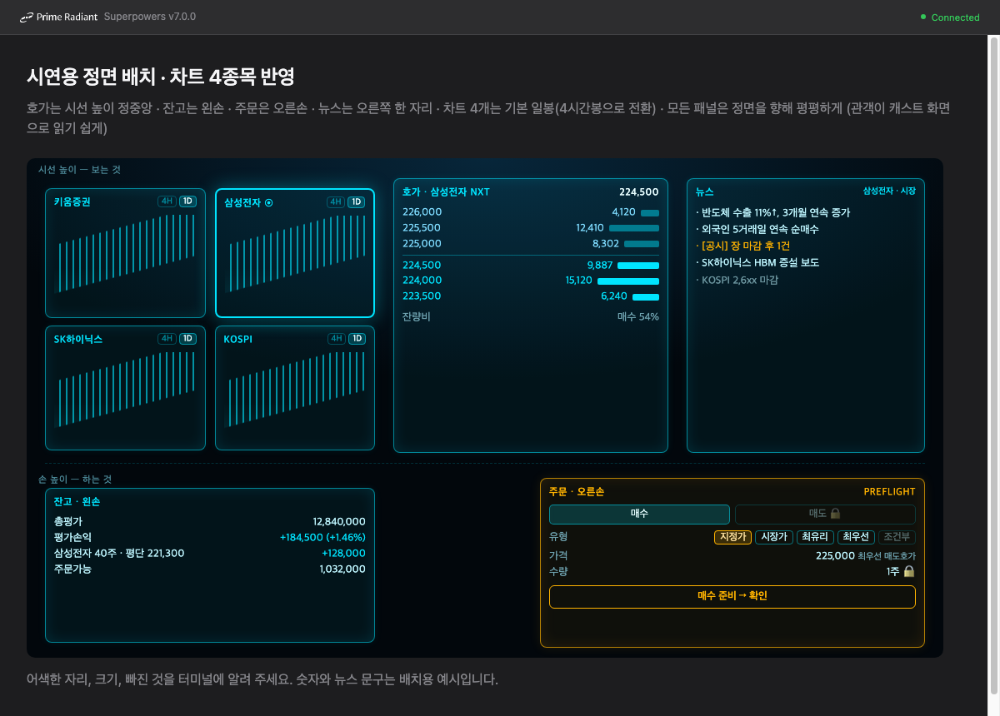

# 트레이더 스프레드 — 시연용 정면 작업공간 설계

작성 2026-10-28. 상위 설계: [투자 자비스 설계](2026-10-27-investment-jarvis-design.md). 이 문서는 지금 헤드셋에 떠 있는 "삼성전자/SK하이닉스 선택 패널" 셸을 대체할 메인 작업공간을 정한다. 상위 설계의 안전장치(§7), 시각 원칙(§6, §6.1)은 그대로 따른다.

표기: **(사용자 결정)** 은 사용자가 직접 정한 것, **(Claude 판단)** 은 Claude가 정하고 사용자에게 알린 것이다.

목업은 배치만 보여 준다. 숫자, 뉴스 문구, 차트 모양은 예시다.

## 1. 의도와 이유

2026-10-28에 실데이터가 들어온 기존 패널을 보고 사용자가 이렇게 말했다. "간지가 안 나잖아. 진짜 트레이딩 하는 사람이 볼 법한 매수·매도 호가창, 내 잔고 같은 게 한 번에 쫙 펼쳐져야 해."

목표는 두 가지다.

1. **첫눈의 "와".** 헤드셋을 쓰는 순간, 그리고 청중이 캐스트 화면을 보는 순간, 실제 트레이더의 자리가 눈앞에 펼쳐진다.
2. **"XR 시대에는 화면이 부품이 된다"는 레슨을 무대에서 증명.** 모든 패널을 옮기고, 크기를 바꾸고, 재구성하고, 손으로 치워 없앨 수 있어야 한다. 이것은 상위 설계 테제 5(HTS의 귀환, 공통 데이터 위의 독립 컴포넌트)와 §6.1 차트 컴포넌트화의 연장이다. **(사용자 결정)**

**이 화면은 시연용이다.** 모든 결정은 "캐스트 화면에서 관객이 바로 읽히는가"를 먼저 따진다. **(사용자 결정)**

## 2. 목표, 비목표, 안티골

**목표**
- 헤드셋을 쓰면 아래 §3 배치가 실제 키움 데이터로 펼쳐진다.
- 차트 하나를 고르면 호가와 주문이 그 종목으로 바뀐다.
- 모든 패널을 손으로 옮기기, 크기 조절, 재구성, 치워 없애기, 되살리기를 할 수 있다.
- 에디터와 Meta XR Simulator에서도 같은 장면을 재현할 수 있다(개발 수단이자 발표 백업).

**비목표**
- 매도, 정정, 취소, 신용 주문. 주문 안전장치는 상위 설계 §7 그대로다.
- 사용자 지정 종목 검색과 관심종목 관리. 시연 종목은 고정이다.
- 기술적 지표 라이브러리(이평선, MACD 등). 차트 겹 분해 장면(S2-b)은 별도 계획이다.
- 뉴스 본문 읽기와 요약. 헤드라인과 공시 제목만 다룬다.

**안티골**
- 패널이 비스듬히 기울어 캐스트 화면에서 안 읽히는 것. 사용자가 대각선 배치를 명시적으로 거부했다.
- 재구성하다가 패널이 겹치거나 화면 밖으로 사라져 시연이 꼬이고, 복구할 방법이 없는 것.
- 예시나 합성 데이터를 실제처럼 보이게 하는 것. 상위 안티골과 같다.
- 주문 유형 선택이 안전장치를 우회하는 것. 예를 들어 다른 종목을 고르면 주문이 열리는 것.

## 3. 배치 (사용자 결정)

모든 패널은 사용자를 정면으로 향하고 평평하다. 비스듬한 책상형 기울기는 쓰지 않는다.

| 위치 | 패널 | 내용 |
|---|---|---|
| 시선 높이, 왼쪽 | 차트 4개 (2×2) | 키움증권 039490, 삼성전자 005930, SK하이닉스 000660, KOSPI 지수. 기본 일봉. 각 칸에서 4시간봉/일봉을 바꾼다. |
| 시선 높이, 정중앙 | 호가창 | 선택된 종목의 매도/매수 호가, 잔량 막대, 현재가, 잔량비. 가장 크다. |
| 시선 높이, 오른쪽 | 뉴스 | 한 칸을 세로로 길게 차지한다. 증권 뉴스 RSS 헤드라인과 OpenDART 공시 제목. |
| 손 높이, 왼쪽 | 잔고 | 총평가, 평가손익(금액, %), 보유 종목별 수량·평단·손익, 주문가능 금액. |
| 손 높이, 오른쪽 | 주문 | 매수/매도 탭(매도 잠금), 주문 유형, 가격, 수량(1주 잠금), "매수 준비 → 확인". |

시선 높이와 손 높이 사이의 구분선은 의미상 경계다. 위는 보는 것, 아래는 하는 것이다. **(Claude 판단)**

## 4. 상호작용

### 4.0 입력 방식
상위 설계를 따라 손 추적(핀치, 잡기, 두 손)이 기본 입력이다. Meta XR Simulator에서는 시뮬레이터의 손/컨트롤러 에뮬레이션으로 재현하고, Mac 에디터 백업은 마우스로 한다(잡기는 드래그, 모서리는 드래그, 치우기는 빠른 드래그, 트레이는 단축키). 컨트롤러 전용 설계는 하지 않는다.

### 4.1 선택 (사용자 결정)
- 차트 한 칸을 고르면 그 칸이 선택 상태가 되고(밝은 테두리), 호가창과 주문창이 그 종목으로 바뀐다.
- KOSPI는 호가가 없는 지수다. 고르면 호가창은 "지수 · 호가 없음"을 표시하고 주문은 잠긴다. **(Claude 판단)**
- 삼성전자가 아닌 종목을 고르면 주문창은 잠기고 이유를 표시한다(예: "시연 안전장치: 삼성전자만"). 호가와 차트는 정상적으로 바뀐다. **(Claude 판단)**

### 4.2 컴포넌트화: 옮기기, 크기, 재구성 (사용자 결정)
- **모든 패널이 독립 부품이다.** 차트 각각, 호가, 뉴스, 잔고, 주문이 모두 해당한다.
- **옮기기:** 패널을 잡아서 다른 위치로 옮긴다.
- **크기 조절:** 모서리를 잡아 늘리거나 줄인다.
- **재구성:** 호가를 차트 옆에 붙이거나, 차트 하나를 크게 키우고 나머지를 줄이는 식으로 자유롭게 바꾼다.
- **격자 맞춤:** 놓는 순간 보이지 않는 격자에 착 붙어 정렬된다. 시연 중 손떨림에도 깔끔해야 하기 때문이다. **(Claude 판단)**
- **크기에 따른 정보량:** 크기가 정보 밀도를 정한다(상위 §6.1 의미 기반 줌). **(Claude 판단)**
  - 차트는 작으면 선과 종가, 기본 크기에서 봉과 거래량, 크게 키우면 봉, 거래량, 가격축 눈금과 시간축 라벨을 보여 준다.
  - 호가는 작으면 5단, 크면 10단이다.
- **배치 프리셋:** 기본 배치는 "트레이더 기본"이다. 한 동작으로 기본 배치로 되돌릴 수 있다. 시연이 꼬였을 때의 복구 수단이다. **(Claude 판단)**

### 4.3 치우기와 되살리기
- **치우기 (사용자 결정):** 보기 싫은 패널은 손동작 하나로 바로 없앤다. 시연에서 이 동작 자체를 보여 준다.
- **손동작 종류 (Claude 판단):** 패널을 잡아 옆으로 던지기(flick)를 기본으로 한다. 패널은 날아가며 사라지는 짧은 애니메이션과 소리를 낸다. 실제 제스처는 Meta Interaction SDK에서 오인식이 적고 캐스트에서 잘 보이는 것으로 빌더가 고른다.
- **되살리기 (Claude 판단):** 치운 패널은 손바닥을 뒤집으면 나오는 트레이에 아이콘으로 남는다. 아이콘을 잡아 끌어내면 다시 놓인다. "기본 배치로" 동작도 트레이에 있다.
- **주문 패널 치우기 (Claude 판단):** 주문 패널을 치우면 진행 중인 주문 준비(PREFLIGHT)는 취소된다. 주문 상태가 화면 밖에 숨어 있으면 안 되기 때문이다.

## 5. 패널별 상세

### 5.1 차트
- 상승은 속 빈 봉, 하락은 채운 봉이다. 색은 시안 하나만 쓰고 +/− 부호를 함께 표시한다. 상위 §6.1 원칙 9와 사용자 결정 그대로다.
- **일봉:** 종목은 ka10081 계열, KOSPI는 업종일봉 ka20006을 쓴다. 정확한 API는 빌더가 문서로 확인한다.
- **4시간봉:** 키움에 없으므로 60분봉 4개를 묶어 만든다. 종목은 ka10080 `tic_scope=60`, KOSPI는 업종분봉 ka20005를 쓴다. **(Claude 판단)**
  - 묶는 기준은 장 시작 시각부터다. 정규장 09:00 기준이며 NXT 시간대는 별도 시리즈로 둔다. 빌더가 정하되 KRX와 NXT 봉을 섞지 않는다.
- **실시간 갱신:** 마지막 봉을 갱신한다. 종목은 기존 0B 체결, KOSPI는 0J 업종지수 실시간을 쓴다.
- **상태 표시:** 기존 정직성 규칙(LIVE, DELAYED, 장 마감, DISCONNECTED 라벨)을 각 패널에 그대로 둔다.

### 5.2 호가창
- 선택 종목의 0D 실시간 호가를 쓴다. 시장(KRX/NXT) 라벨을 표시한다.
- 매도는 위, 매수는 아래, 가운데에 현재가 구분선을 둔다. 잔량은 막대로, 잔량비(매수 %)도 표시한다.
- 크기에 따라 5단 또는 10단이다(§4.2).

### 5.3 뉴스 (사용자 결정: 증권 뉴스 RSS + OpenDART)
- **OpenDART 공시:** 선택 종목과 시연 종목들의 최근 공시 제목, 시각, 유형을 보여 준다. 공시는 앰버 태그로 구분한다.
- **증권 뉴스 RSS:** 시장과 종목 헤드라인을 보여 준다.
  - 피드 선정은 빌더가 하되, 무료이고 한국어이며 안정적인 1–3개로 한다. **(Claude 판단)**
  - 선택 종목명이 들어간 기사를 위로 올린다. **(Claude 판단)**
- **키 관리:** DART 키는 team-03 `members/gejyn14/app/.env`의 `DART_API_KEY`와 같은 값을 `gateway/.env`에 둔다. 키움 키와 같은 취급이다(로그 금지, 커밋 금지).
- **가져오는 쪽:** 게이트웨이가 가져와 정리하고, 헤드셋에는 정리된 목록만 스트림으로 보낸다. 가져오는 주기는 빌더가 정하되 과호출하지 않는다. **(Claude 판단)**
- **출처 표시:** 각 항목에 출처와 시각을 표시한다. 시연용으로 기사를 고르거나 꾸미지 않는다.

### 5.4 잔고
- 계좌평가잔고 kt00018로 총평가, 평가손익, 보유 종목, 주문가능 금액을 받는다(주문가능은 kt00010 등). 보유 변동은 실시간 04 잔고로 받는다.
- 장 마감이나 NXT 시간대처럼 값이 움직이지 않는 패널은 기존 정직성 라벨(장 마감, DELAYED)로 마지막 값을 보여 준다. KOSPI는 NXT 세션이 없으므로 NXT 시간대 시연 중에는 "장 마감" 일봉이 정상이다. **(Claude 판단)**
- 계좌번호는 마스킹한다. 상위 설계대로, 첫 실주문 전에 마스킹된 계좌를 사용자에게 확인받는다.
- **국내주식만 보여 준다 (사용자 결정).** 사용자는 국내주식 보유가 없으므로 금액 공개 부담이 없다. 가림 토글은 만들지 않는다.
- **빈 상태도 잘 보여야 한다.** 보유가 없을 때 잔고 패널은 "보유 종목 없음"과 주문가능 금액을 보여 준다. 빈 칸이 아니라 의도된 상태로 보이게 디자인한다. **(Claude 판단)**
- **시연 연결점.** S4에서 삼성전자 1주 실주문이 체결되면 실시간 04 잔고로 이 패널에 첫 보유 종목이 나타난다. 그래서 이 계획의 잔고 패널은 실시간 보유 변동을 받아 행을 추가하는 것까지 만든다. **(Claude 판단)**

### 5.5 주문
- **표시:** 매수/매도 탭(매도는 잠금 표시), 주문 유형, 가격, 수량(1주 잠금), 상태 배지(PREFLIGHT 또는 LIVE)를 둔다. 확정은 "매수 준비 → 확인" 2단계다.
- **주문 유형 (사용자 결정):** 지정가, 시장가, 최유리, 최우선을 표시하고, 조건부는 흐리게 둔다.
  - 시간대(KRX 정규장, NXT)에 따라 실제로 가능한 유형만 활성화한다. kt10000 매매구분 값과 NXT 지원 여부는 빌더가 키움 문서로 확인한다.
  - 기본값은 상위 설계를 따른다. 정규장은 시장가, NXT는 최우선 매도호가 지정가다.
- **안전장치:** 상위 §7과 같다. 서버 하드코딩: 005930만, 1주, 매수만, 세션 내, 동시 1건, 재시도 없음, 일일 3건, 기본 PREFLIGHT, LIVE는 환경 플래그와 앱 내 무장 둘 다 필요.
  - 클라이언트가 보낸 유형이나 가격이 서버 규칙과 다르면 서버가 거부한다.
  - **실주문 경로 자체는 이 계획의 범위가 아니다.** 상위 설계의 주문 흐름(S4) 계획에서 만든다. **(Claude 판단)**
  - 이 계획의 주문 패널은 UI까지만 한다. 매수/매도 탭, 유형 선택, 가격과 수량 표시, "매수 준비"를 누르면 보낼 내용을 보여 주는 미리보기 카드가 범위다.
  - 게이트웨이 주문 엔드포인트는 만들지 않는다. `/v1/orders`는 계속 404다.
  - 유형별 가격 규칙, 서버가 허용하는 유형 목록, 실제 사전점검 호출은 S4 계획에서 정한다.
  - 이 계획에서 유형 활성화는 시간대별 표(정규장, NXT)를 헤드셋 쪽 상수로 둔다. 근거는 키움 문서다. S4에서 서버 규칙과 맞춘다. **(Claude 판단)**

## 6. 시각

상위 §6을 따른다. 자비스 홀로그램 시안 #00e5ff, 경고·주문 확정·공시는 앰버, 얇은 발광 테두리, 어두운 반투명 바탕이다. 추가로:
- **글자 크기는 캐스트 기준이다.** 캐스트 해상도에서 숫자가 읽히는 최소 크기를 빌더가 정하고 지킨다.
- **이 계획의 시각 수준:** 목업 수준의 깔끔한 홀로그램 패널이다. 부팅 연출(S1)과 차트 분해(S2-b) 같은 큰 연출은 별도 계획이다. 다만 옮기기, 크기 조절, 치우기 애니메이션은 이 계획에서 "와"가 나올 만큼 다듬는다.

## 7. 데이터 흐름

기존 게이트웨이 `/v1/stream` 구조를 확장한다. 게이트웨이는 키움, DART, RSS를 모아 정리하고, 헤드셋은 정리된 관측값만 받는다. 키와 토큰은 헤드셋에 가지 않는다.

**새로 필요한 능력 (빌더가 계약을 정함)**
- 일봉, 4시간봉, 지수 차트
- 지수 실시간
- 잔고
- 주문가능 금액
- 뉴스와 공시 목록
- 주문 유형 가용성(시간대별)

**구독 방식:** 헤드셋은 시연 종목 4개를 늘 구독한다. 호가(0D)는 선택된 종목만 받아도 되고, 4개 모두 받아도 된다. 키움 등록 한도를 보고 빌더가 정한다.

## 8. 제약

- 발표 11월 말, 헤드셋 Quest 3 계열(2026-10-29 도착), 에디터와 Meta XR Simulator로 재현 가능해야 한다.
- 실전 도메인만 쓴다. 키움 키는 `gateway/.env`에서 읽는다. 주의: `~/.zshrc`에 다른 `KIWOOM_APPKEY`가 export되어 있어 `uv --env-file`보다 우선한다. 실행 시 정리해야 한다.
- 금융 값은 float를 거치지 않는다(기존 규칙).
- 키움 조회 오류 1700–1702 백오프와 8005 재발급 제한은 기존 규칙을 그대로 따른다.

## 9. 범위와 우선순위

시간은 한 달이며, §3–§5의 모든 항목이 범위 안이다. 빼는 순서는 정하지 않는다. **(사용자 결정)**

## 10. 빌더에게 맡기는 것

- 각 키움 API의 정확한 요청과 응답 필드(위 API 번호는 kiwoom-cli 목록 기준 출발점)
- RSS 피드 선정, 뉴스와 공시를 가져오는 주기
- 치우기 제스처의 구체 구현, 격자 크기, 크기별 정보량 단계의 기준
- 4시간봉 묶는 기준의 세부(§5.1 원칙 안에서)
- 캐스트 기준 최소 글자 크기
